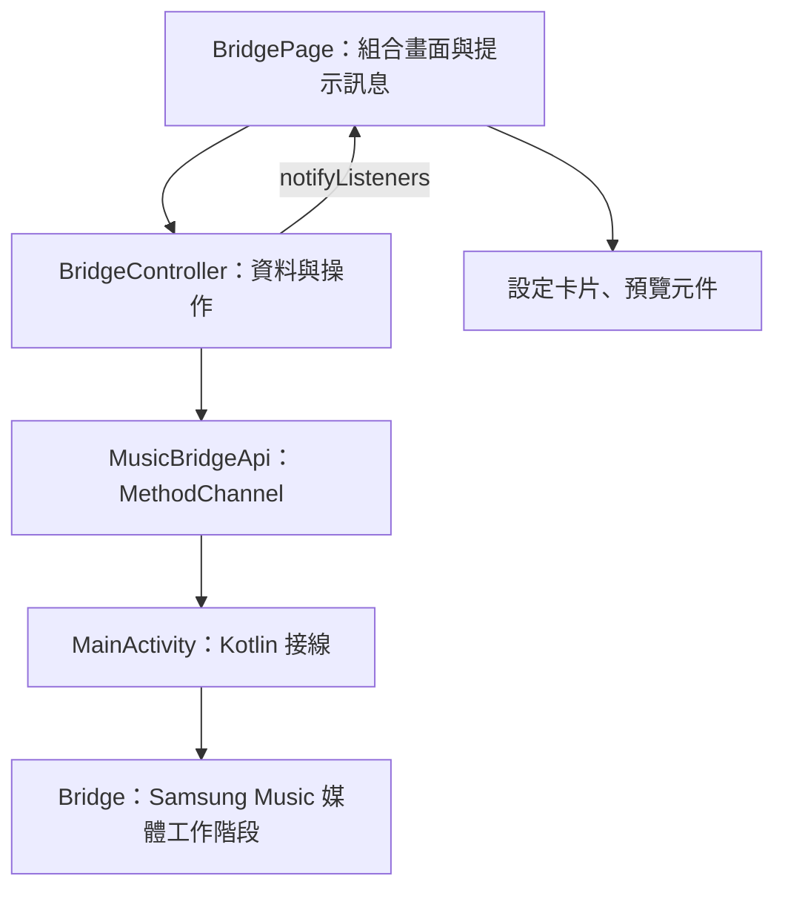

# 架構與實作說明

本文說明 Flutter 設定頁與 Kotlin 桌面小工具的模組分工、資料流及實作方式。
Flutter 狀態管理使用內建的 `ChangeNotifier` 和 `AnimatedBuilder`。

## 1. Flutter 畫面與 Android 桌面小工具

Flutter 的 `Widget` 是 App 裡的畫面組件，例如 `Text`、`Row`、`Container`。
Android 桌面 Widget 是 Launcher 上的小工具，必須透過 Kotlin 的 `RemoteViews` 與 XML 製作。

所以改 Flutter 預覽不會自動改到桌面小工具；如果修改版面或顏色，通常要同步兩邊。
App 設定頁關閉後，背景播放與同步仍由 Android 服務處理，並不靠 Flutter 頁面的計時器維持。

## 2. 模組索引

| 順序 | 檔案 | 主要內容 |
| --- | --- | --- |
| 1 | [main.dart](../lib/main.dart) | `main()`、`runApp()`、`import` |
| 2 | [app.dart](../lib/app.dart) | 全域主題、首頁與 `StatelessWidget` |
| 3 | [bridge_page.dart](../lib/pages/bridge_page.dart) | 頁面生命週期、畫面由哪些元件組成 |
| 4 | [appearance_controls.dart](../lib/widgets/appearance_controls.dart) | 輸入參數、按鈕 callback、Slider |
| 5 | [music_preview.dart](../lib/widgets/music_preview.dart) | Row、Column、Expanded、Spacer 和元件拆分 |
| 6 | [bridge_controller.dart](../lib/controllers/bridge_controller.dart) | 狀態、草稿、儲存與非同步更新 |
| 7 | [music_bridge_api.dart](../lib/services/music_bridge_api.dart) | Flutter 如何呼叫 Kotlin |
| 8 | [playback_snapshot.dart](../lib/models/playback_snapshot.dart) | 如何把原生 Map 轉成明確資料型別 |

其他元件：

- `widgets/playback_mode_icons.dart`：循環／隨機圖示、讀屏文字與自訂繪圖。
- `models/appearance_settings.dart`：外觀設定、固定 90% 字體比例。

元件按「有獨立用途的畫面區塊」拆分，沒有把每個 `Text` 都拆成檔案。
同一檔案內的小元件，例如 `_PreviewSongRow`，用底線表示檔案私有。

## 3. 整體資料流



`BridgeController` 不知道頁面長什麼樣；畫面元件也不知道 Android 如何存檔。
`BridgePage` 負責把它們接起來。

## 4. StatelessWidget 與 StatefulWidget

`StatelessWidget`：元件本身沒有需要管理的可變狀態；父層給什麼資料，它就畫什麼。
例如 `OpacityCard(opacity: ..., onChanged: ...)` 不自己保存不透明度。

`StatefulWidget`：需要配對一個 `State`，管理初始化、關閉等生命週期。
本專案的 `BridgePage` 用它來建立／釋放控制器，並觀察 App 回到前景。

「無狀態」不代表不會重畫。父層傳入新資料時，StatelessWidget 仍然可以重新 `build()`。
`build()` 應該描述畫面，不要在裡面啟動 Timer 或呼叫儲存，否則每次重畫都可能重複執行。

常見生命週期：

1. `initState()`：這個 State 建立後執行一次，建立控制器與監聽。
2. `build()`：Flutter 需要更新畫面時執行，可能執行很多次。
3. `didChangeAppLifecycleState()`：App 回到前景時重新讀取權限／播放資訊。
4. `dispose()`：取消 Timer、移除監聽，避免離開後還有工作持續通知舊畫面。

## 5. 畫面為什麼會更新

本專案由控制器管理頁面狀態，透過 `notifyListeners()` 通知畫面更新：

```dart
void changeOpacity(double opacity) {
  draft = draft.copyWith(opacity: opacity);
  _notify(); // 內部呼叫 notifyListeners()
}
```

頁面的 `AnimatedBuilder(animation: _controller, builder: ...)` 收到通知後，重新執行 `builder`。
它名稱雖然叫 AnimatedBuilder，也能監聽一般 `Listenable`，不一定要做動畫。

一個 Slider 操作會依序經過：

1. 使用者拖動 `OpacityCard` 裡的 Slider。
2. Slider 的 `onChanged` 呼叫父層傳來的函式。
3. 函式是控制器的 `changeOpacity`。
4. 控制器更新 `draft` 並通知頁面。
5. 頁面把新不透明度交給 Slider 與預覽，所以兩邊一起更新。

這叫「資料向下、事件向上」。子元件不必知道資料儲存在哪裡。

## 6. 草稿和已儲存設定

`AppearanceSettings` 的欄位是 `final`，建立後不能直接重新指定。
`copyWith` 會產生新物件，只替換指定欄位，其他沿用舊值。

```dart
final original = AppearanceSettings(mode: 'dark', opacity: .35);
final next = original.copyWith(opacity: .6);
// original 仍然是 .35，next 是 .6；兩者都是 dark。
```

- `draft` 是畫面正在編輯的設定。
- `_saved` 是最後成功儲存的設定，底線表示只能在該 Dart 檔案存取。
- 取消：把 `draft` 還原成 `_saved`，不向 Kotlin 寫入。
- 儲存：先呼叫原生儲存，成功後才把 `_saved` 更新成送出的設定。
- 儲存失敗：保留原 `_saved`，畫面提示錯誤，按鈕恢復可操作。

`opacity` 的資料範圍是 `0～1`，顯示時乘以 100 才是百分比。

## 7. async、await、Future 與 mounted

`Future<T>` 表示稍後才取得的結果，`async` 函式可以用 `await` 等它完成。
等待平台呼叫不等於把整個 UI 卡住；Flutter 還能處理畫面和其他事件。

```dart
final next = await _api.loadSnapshot();
```

等結果時，使用者可能已離開設定頁：

- 頁面顯示 Snackbar 前檢查 `mounted`，避免使用已經失效的 `context`。
- 控制器檢查 `_disposed`，避免更新已銷毀控制器的監聽者。
- `_refreshing` 避免兩秒輪詢與返回前景的更新同時送出重複請求。
- `finally` 不論成功或失敗都執行，用於重置「儲存中」或「讀取中」。
- `unawaited(...)` 表達「啟動這個非同步工作，但這裡不等待」；相關工作仍需自行處理錯誤。

不要把所有例外都吞掉。本專案的載入錯誤會顯示在頁面，操作錯誤由頁面顯示 Snackbar。

## 8. 版面常用元件

| 元件 | 在本專案的用途 |
| --- | --- |
| `Row` | 左側專輯圖、右側歌曲資訊；橫向五個控制鍵 |
| `Column` | 歌名和演出者上下排列 |
| `Expanded` | 在 Row / Column 裡取得剩餘空間；必須位於 Flex 版面之下 |
| `Spacer` | 把控制列推到封面底部 |
| `SizedBox` | 固定封面大小、控制列高度或留白 |
| `Padding` | 內容與邊緣的距離 |
| `Container` | 背景色、圓角與外距等裝飾 |
| `ListView` | 設定頁可以上下捲動 |
| `Stack` / `Positioned` | 疊放循環箭頭與 A 字圖示 |
| `IconTheme` | 統一子元件圖示顏色 |
| `Semantics` | 給讀屏軟體的圖示文字描述 |

長文字需要有寬度限制才知道何時截斷，因此歌曲資訊放進 `Expanded`。
Flutter 預覽使用省略顯示；真正桌面歌名跑馬燈在 Android 的 `music_widget.xml`。

## 9. 常見 Dart 寫法

| 寫法 | 意思 |
| --- | --- |
| `final` | 變數建立後不能重新指定；不代表物件的所有內部內容都不可修改 |
| `const` | 可以在編譯時建立常數物件；輸入也必須可當常數 |
| `String?` | 可能是字串，也可能是 null |
| `value ?? fallback` | 左邊是 null 才使用右邊預設值 |
| `value?.method()` | value 不是 null 才呼叫 |
| `value!` | 告訴編譯器這裡不是 null；判斷錯仍會在執行時出錯 |
| `required` | 呼叫建構子時必須提供此命名參數 |
| `List<QueueSong>` | 清單裡每一項都是 QueueSong |
| `Map<String, dynamic>` | 字串 key，value 尚未限定型別的資料表 |
| `get playing => ...` | 用屬性語法讀取的 getter |
| `() => callback(value)` | 建立稍後執行的函式，不是在 build 時立即呼叫 |
| `if (...) ...[a, b]` | 條件成立時，把 a、b 展開加入清單 |

`PlaybackSnapshot` 把原生 Map 的轉換集中起來，讓元件不必到處寫 `as int?`。
`MediaAction` 的位元旗標只是播放器回報的能力，不是 Android 權限。

## 10. Android 程式各自負責什麼

檔案位於 `android/app/src/main/kotlin/com/example/music_bridge/`。

| 檔案 | 責任 |
| --- | --- |
| `MainActivity.kt` | MethodChannel 接線、系統設定入口與外觀儲存 |
| `Bridge.kt` | MediaSession 連線、播放回呼、狀態快照與控制 |
| `MusicListener.kt` | 系統通知監聽服務，維持背景觀察 |
| `MusicWidget.kt` | 新增／縮放／點擊等系統廣播入口 |
| `MusicWidgetRenderer.kt` | 把目前狀態轉成 RemoteViews 並更新桌面 |
| `BackgroundPlayback.kt` | 未開啟播放器時背景喚醒、等待與點歌，不開視窗 |
| `SongSelection.kt` | 用穩定歌曲身分比對新佇列，避免使用過期編號 |
| `PlaybackCache.kt` | 有效清單儲存與離線顯示；不假裝仍在播放 |
| `Artwork.kt` | 非同步解碼專輯圖，避免切歌後舊圖片覆蓋新圖片 |
| `ShuffleObservation.kt` | 比對 Samsung 回報模式與佇列，不自行洗牌冒充同步 |
| `PlaybackVisualState.kt` | 決定哪些狀態改變需要重畫 |

桌面點歌：`MusicWidget` → `BackgroundPlayback` → `Bridge` → Samsung Music。
設定頁儲存：Flutter `MusicBridgeApi` → `MainActivity` → SharedPreferences → `MusicWidgetRenderer`。
播放器主動變更：MediaController 回呼／MusicListener → `Bridge` → `MusicWidgetRenderer`。

修改 channel 名稱或方法名稱時，Dart 與 Kotlin 必須一起改。
不要把清單點歌改成啟動 Activity，否則會重新出現畫面閃動。

## 11. 想改某個功能，先找哪裡

| 想改的內容 | 先看檔案 |
| --- | --- |
| App 全域主題 | `lib/app.dart` |
| App 啟動圖示 | `assets/icons/app_icon.png`，再執行 `tools/generate_app_icons.ps1` 產生 Android 圖示 |
| 設定頁區塊順序 | `lib/pages/bridge_page.dart` |
| 背景色選項或 Slider 外觀 | `lib/widgets/appearance_controls.dart` |
| Flutter 預覽的封面／間距／文字樣式 | `lib/widgets/music_preview.dart` |
| 預覽循環、隨機圖示 | `lib/widgets/playback_mode_icons.dart` |
| 取消、儲存、輪詢邏輯 | `lib/controllers/bridge_controller.dart` |
| 增加一個 Kotlin 呼叫 | `lib/services/music_bridge_api.dart` 和 `MainActivity.kt` |
| 桌面頂部版面／跑馬燈 | `android/app/src/main/res/layout/music_widget.xml` |
| 桌面歌曲列版面 | `android/app/src/main/res/layout/queue_row.xml` |
| 桌面文字顏色／圖示縮放 | `MusicWidgetRenderer.kt` |

例如改歌名大小：預覽在 `music_preview.dart`，桌面實際大小在 `MusicWidgetRenderer.kt`。
只修改 XML 的 `textSize` 可能被程式中的 `setTextViewTextSize` 覆蓋。

## 12. 修改後怎麼驗證

在專案根目錄執行：

```powershell
flutter analyze
flutter test
flutter build apk --debug
```

Android 單元測試：

```powershell
.\android\gradlew.bat -p android :app:testDebugUnitTest --console=plain
```

`test/appearance_test.dart` 檢查設定頁保存、取消、窄螢幕排版與目前歌曲顏色。
`test/bridge_controller_test.dart` 用假服務測試非同步、儲存失敗與離線選曲身分，不需要手機。

Hot reload 適合 Flutter 畫面修改。修改 Kotlin、Android XML 或 Manifest 後，需要重新建置安裝。
單元測試無法代替 Samsung 真機測試；背景喚醒、Launcher 跑馬燈與實際 MediaSession 能力仍要在手機確認。
